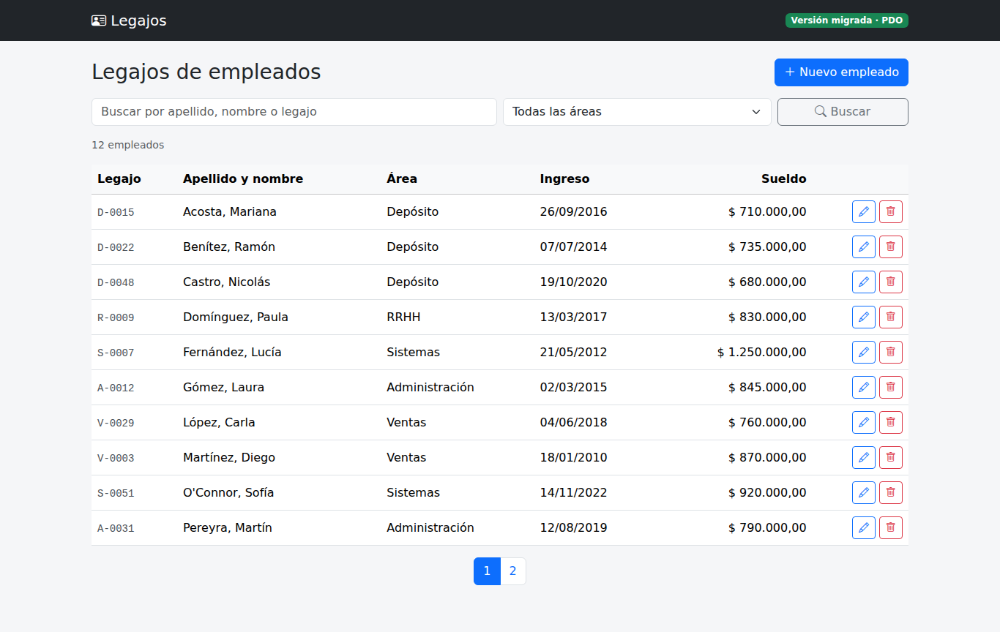
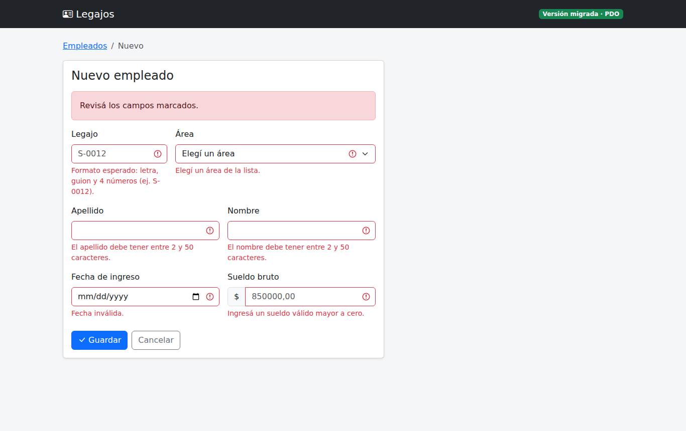

# Migrating a PHP 4 module to PDO

🇦🇷 [Leer en español](README.md)

A **legacy maintenance** case study: an employee records CRUD written in PHP 4 style (`mysql_*`, `register_globals`, concatenated SQL) migrated to **PHP with PDO**, compatible with PHP 5.6 and 8.x, using Bootstrap 5 and jQuery.

The repository keeps **both versions** so the before and after can be compared:

| Folder | Contents |
|---|---|
| `legacy/` | Original code. Reference only: it does not run on PHP 7+. Each problem is marked with a `[P1]`…`[P11]` comment. |
| `migrado/` | New, working version. The same `[Pn]` tags show where each problem was fixed. |
| `docs/MIGRACION.md` | Migration log (Spanish): work order and each problem with before/after code. |

The application UI and code identifiers are in Spanish, since it targets an Argentine company.

## What was fixed

| # | Problem in the old code | Fix |
|---|---|---|
| P1 | Database user and password hardcoded | Environment variables or a git-ignored `config.local.php` |
| P2 | `mysql_*` functions (removed in PHP 7) | PDO with a single shared connection |
| P3 | Errors hidden with `@` or shown to the user with the SQL | Exceptions, `error_log()` and a generic message |
| P4 | Relies on `register_globals` | Explicit reads from `$_GET` / `$_POST` |
| P5 | XSS: data printed unescaped | `htmlspecialchars` on every output |
| P6 | SQL injection in search, create, update and delete | Prepared statements and escaped `LIKE` wildcards |
| P7 | No pagination | `COUNT` + `LIMIT/OFFSET` bound as integers |
| P8 | Delete via GET, no confirmation or CSRF protection | Confirmation modal, POST and CSRF token |
| P9 | No input validation | Server-side validation with per-field errors |
| P10 | SQL, logic and HTML in the same file | Separate data layer, helpers and views |
| P11 | MyISAM table with dates and salaries stored as text | Migration script to InnoDB, `DATE`, `DECIMAL` and indexes |

## Features of the migrated version
- List with search by last name, first name or employee ID, department filter and pagination.
- Single create/edit form with validation: unique ID in `S-0012` format, real non-future date, salary in Argentine number format (`850.000,50`).
- Delete with a confirmation modal.
- jQuery formats the employee ID as you type and drives the delete modal.
- Mobile-friendly layout.

## Documented test cases
| # | Case | Old system | Migrated |
|---|---|---|---|
| 1 | Search `' OR '1'='1` | Returns the whole table | 0 results |
| 2 | Open `borrar.php?id=0 OR 1=1` | Deletes every employee | `eliminar.php` only accepts POST with a token: 405 |
| 3 | Last name `<script>alert(1)</script>` | Script runs on the list page | Shown as text |
| 4 | Search `O'Connor` | SQL error on screen | Found |
| 5 | Create with a duplicate ID | Saved as a duplicate | "An employee with that ID already exists" |
| 6 | Hire date `2021-02-30` | Saved as is | "Invalid date" |
| 7 | Salary `850.000,50` | SQL error or truncated value | Saved as 850000.50 |
| 8 | Database down | MySQL error shown | Generic message; details go to the log |

Cases 1, 2, 4, 5, 6 and 7 are automated in `migrado/tests/pruebas.php`, along with create, update, delete and pagination.

## Running it
**Local (demo mode, no MySQL needed):**
```bash
cd migrado
php -S localhost:8000
```
Open `http://localhost:8000`. It creates `data/demo.sqlite` with 12 sample employees.

**Tests:**
```bash
cd migrado
php tests/pruebas.php
```

**Server with MySQL (e.g. InfinityFree):**
1. New database: run `migrado/sql/schema.sql` in phpMyAdmin. Existing database: back it up and follow `migrado/sql/migracion.sql` step by step.
2. Copy `includes/config.local.ejemplo.php` to `includes/config.local.php` and fill it in.
3. Upload the contents of `migrado/` to `htdocs/`.

Requires PHP 5.6+ with PDO (`pdo_mysql`, or `pdo_sqlite` for demo mode).

## Screenshots (migrated version)
| List | Validation |
|---|---|
|  |  |
